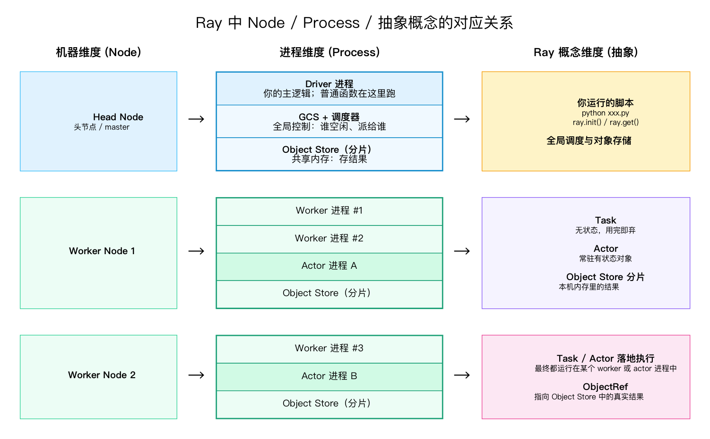
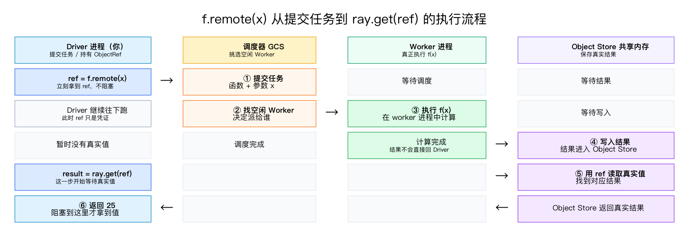
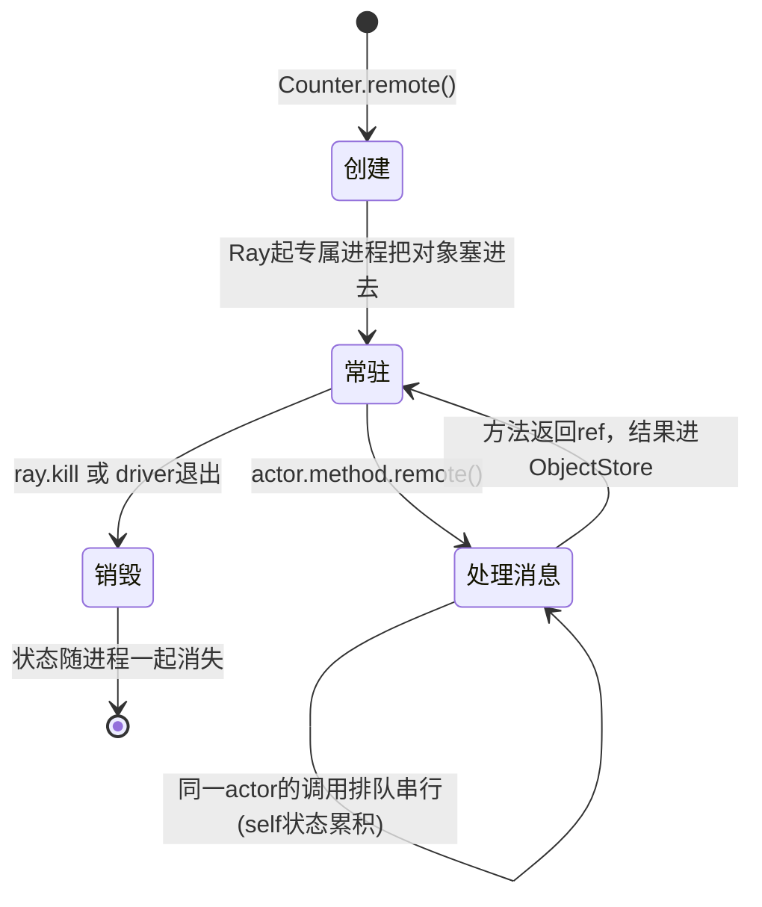
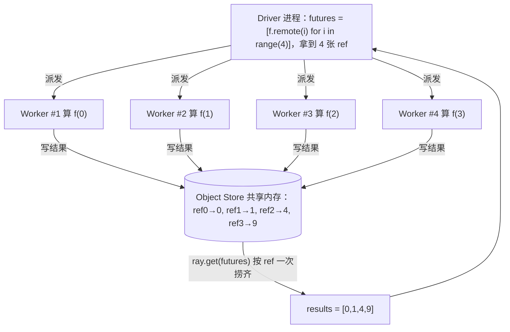

`remote` 很适合把任务分发、异步执行和结果回收这几件事统一起来；但遇到全局锁、共享状态、阻塞调用时，仍然需要结合 `actor`、`ray.wait` 或外部存储来明确控制并发边界。

本文先回顾 Ray 的基本用法，再展开一些数据处理场景中的组合技巧。

# 先建立一张"维度平行关系图"

理解 Ray 最大的障碍，是把三个不同层面的东西混成一团：**机器、进程、Ray 概念**。
它们是三条平行的维度，一一对应，理清这张图，后面 `remote` / `actor` 全都顺了。



要记住的三句话：

1. **机器(Node)** 是物理/虚拟的服务器；一台机器上跑很多进程。
2. **进程(Process)** 才是"代码真正在哪执行"的单位：driver 是你，worker 是打工的，actor 是常驻打工的。
3. **task / actor** 是 Ray 给你的两种**抽象**，它们最终都落到某个 worker/actor **进程**上去执行。

> 关键澄清：你说的"master 节点"，准确说是 **Head Node 上的 Driver 进程**。没有 `.remote` 的普通函数就在这个 Driver 进程里跑。

---

# `remote` 到底做了什么？

`f.remote(x)` **不是"执行函数"**，而是这样一条流水线：



拆成人话：

| 步骤 | 发生了什么 | 你的直觉误区 |
|---|---|---|
| ① 提交 | 把"函数+参数"打包丢给调度器 | 以为这里就开始算了——**没有** |
| 返回 ref | 立刻给你一张收据(ObjectRef) | 以为 ref 是结果——**它只是凭证** |
| ②③ 执行 | 调度器挑个 worker，在**别的进程**里跑 | 以为在自己进程跑——**不是** |
| ④ 存结果 | 结果不直接返回你，先进 Object Store | 这步最反直觉，下一节专门讲 |
| ⑤⑥ get | `ray.get` 才去共享内存把值取回来 | 以为 get 是"开始算"——**是"取已算好的"** |

> 一句话：**`remote` = 把一段计算"投递"出去并立刻拿到凭证；真正的执行在别的进程，结果先落到共享内存，`get` 再去捞。**

---

# `actor` 做了什么？它"结束之后"呢？

task 跑完进程就回收了；**actor 不一样，它会一直活着**，直到你显式杀掉或脚本结束。



要点：

- **创建**：`Counter.remote()` 让 Ray 起一个**专属进程**，把这个对象常驻进去（它就是个迷你服务器）。
- **调用**：`actor.method.remote()` 是"给那个进程发一条消息"，返回的还是 `ObjectRef`，用法和 task 一样。
- **串行**：同一个 actor 的多个调用**在它自己进程里排队，一条条处理**（它就一个进程、一个邮箱）。
- **"结束之后"**：actor 的状态 `self.xxx` 跟着进程走。**进程一旦销毁（`ray.kill` 或 driver 退出），状态就彻底没了**——它不会自动持久化到磁盘。要保住结果，得在销毁前用 `ray.get` 把它捞出来。

> 所以"actor 结束之后怎么办"的答案是：**结束 = 进程死 = 内存状态消失。** 想要的结果必须在它活着时 `get` 出来，或由 actor 自己写到外部存储（文件/DB）。

---

# 多个 worker 的结果，是怎么"收"回来的？

这是你问的核心。答案是：**没有 worker 直接把结果递给你，所有结果先汇总到 Object Store（共享内存），你拿着一把 ref 去捞。**



两种"收"的策略，对应两个 API：

```python
futures = [f.remote(i) for i in range(4)]

# 策略 A：等齐——ray.get 一把全收（最慢那个会拖住整体）
results = ray.get(futures)

# 策略 B：谁先好先收谁——ray.wait 流式（不被最慢的拖死）
while futures:
    done, futures = ray.wait(futures, num_returns=1)
    handle(ray.get(done[0]))
```

收集机制的本质：

```
worker 之间互相不通信、不汇报
        │
        ▼
全部把结果丢进 Object Store（按 ref 编号存放）
        │
        ▼
Driver 凭手里的 ref 列表，去 Object Store 按需领取
   · ray.get  = 我要这些 ref 的值，全给我（没好就等）
   · ray.wait = 哪些 ref 已经好了？好了的先给我
```

> 所以"worker 之间的关系"其实很简单：**它们彼此不认识，唯一的交汇点是 Object Store。** Driver 不是去找 worker 要结果，而是去**共享内存按收据取货**。这就是为什么 ref（凭证）是整个 Ray 的中枢——它既是"任务的收据"，也是"取结果的提货单"。

---

# ray 基本用法
