> 1. 从 数据 / 模型 / 训练 / 多模态融合方式 这四个角度来看最近的VLA paper
> 2. 分析开源的projects，总结什么样的设计符合当下以及未来的VLA training framework

# 背景：VLA 试图解决什么问题？

从根本上说，VLA 的目标是学习一个策略函数，这个函数决定了在特定情况下应该执行什么动作。我们可以将其形式化地理解为求解一个条件概率：

**P(动作 | 观测)**

这里的“观测”非常丰富，它不仅包含机器人通过摄像头看到的 **视觉（Vision）信息**，还包括我们给出的 **语言（Language）指令**，有时甚至还包含机器人自身的关节状态等本体感知信息。

为了解决这个核心问题，研究者们引入了各种强大的技术。在我们深入具体的论文之前，先来了解几个你会在后文中频繁遇到的关键概念。

### 核心技术与概念

#### 生成模型：如何表征"动作"？

机器人的动作通常是一系列连续、高维的指令（比如关节角度、末端执行器的坐标）。如何让模型学会生成这样复杂的序列呢？目前，**生成模型** 是主流的答案。
- **Diffusion Model**：这是一种强大的生成模型。你可以把它想象成一个"去噪"的过程：模型从一堆完全随机的噪声开始，根据你给定的条件（比如指令"拿起苹果"），一步步地把噪声去除，最终"还原"出符合条件的、有意义的数据——在这里，就是一段连贯的机器人动作序列。这和我们熟知的 Stable Diffusion 文生图的原理非常相似。
- **Flow Matching**：这是另一种与 Diffusion Model 异曲同工的生成技术。如果说 Diffusion Model 是在学习如何"去噪"，那么 Flow Matching 则是在学习数据如何随时间"流动"和"变换"。它通过积分运算来生成结果，这个过程通常更平滑、训练也更稳定。在代码实现上，它们的主要区别在于如何定义训练目标和解码方式。
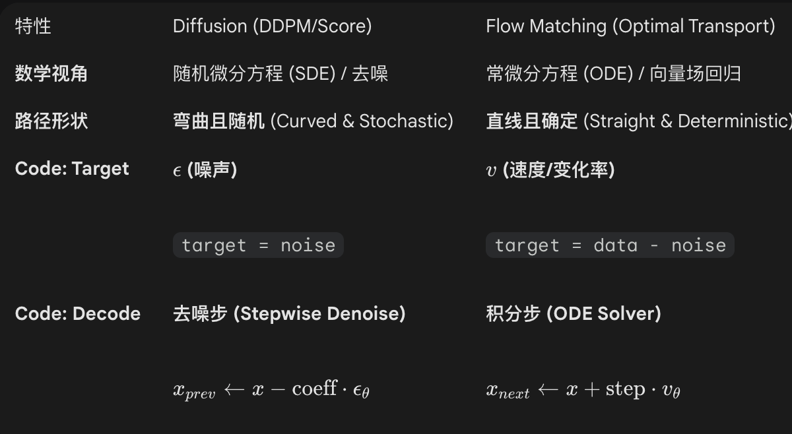

#### 双系统架构 (Dual System / System 2-1)

在很多 VLA 设计中，你会看到一个类似"大小脑"的协同架构：
- **大脑 (System 2)**：负责"思考"和"感知"。它通常是一个参数量巨大的视觉语言模型（VLM），比如基于 Qwen 或 LLaMA 的模型。它的职责是理解复杂的指令、识别图像中的物体和关系，并形成一个高层次的行动规划。
- **小脑 (System 1)**：负责"执行"。它是一个相对轻量级的模型，比如几百兆参数的 DiT (Diffusion Transformer)。它接收来自"大脑"的规划，并将其转化为具体、精准、高频的物理动作。
这种分工合作的设计，旨在兼顾模型的理解能力与执行效率。

#### 视觉特征提取器：DINOv2 & SigLIP

VLA 的第一步是“看懂世界”，这需要强大的视觉编码器。**DINOv2** 和 **SigLIP** 是目前被广泛使用的两种预训练视觉模型。

- [DINOv2](https://arxiv.org/abs/2304.07193) 是一个纯粹的视觉专家，擅长从未标注的图像中学习到丰富的视觉表征。
- [SigLIP](https://arxiv.org/abs/2303.15343) 则是 [CLIP](https://openai.com/research/clip) 的一个重要改进，专注于提升图文匹配和理解的能力。

在很多 VLA 模型中，它们经常被组合使用，以汲取两者之长。

#### 强化学习 (RL) 基础

虽然很多 VLA 的训练方式是模仿学习（Behavior Cloning），但强化学习（Reinforcement Learning, RL）的概念和思想贯穿始终，尤其是在模型优化和评估阶段。这里有几个你必须了解的术语（更详细的入门介绍可以参考 [OpenAI Spinning Up](https://spinningup.openai.com/en/latest/)）：


- **策略 (Policy)**：或称为 **Actor**。它就是智能体（Agent）的大脑，负责根据当前状态输出一个动作。在我们讨论的 VLA 模型中，**VLA 模型本身就扮演着策略的角色**。
- **价值函数 (Value-function)**：它用于评估一个状态的好坏。具体分为两种：

  - **Q(s, a)**：评估在状态 `s` 下，执行动作 `a` 有多好。例如，在“向右转”的指令下，如果模型选择向左走，Q 值就会很低；选择向右走，Q 值则会很高。
  - **V(s)**：只评估当前状态 `s` 本身有多好，不关心具体动作。例如，它能判断出“当前正处于一个能够完成任务的有利位置”，但如果下一步走错了，V 值就会告诉你“现在的位置不太妙了”。

有了这些基础概念，我们就可以画出一张 VLA 的基本工作流程草图，来更直观地理解它的各个组成部分是如何协同工作的。

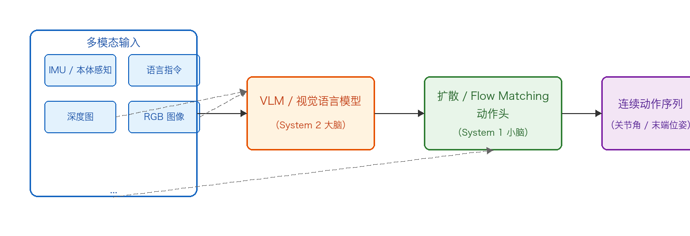

### 关键数据集与开源项目

在深入具体的模型架构之前，我们先来鸟瞰一下 VLA 社区的生态。正是这些开放的数据集和项目，极大地推动了整个领域的发展。

### 主流数据集

训练强大的 VLA 模型离不开大规模、高质量的数据。以下是目前社区中最常用的一些数据集资源：

- **Open-X-Embodiment (OXE)**: 这是一个非常庞大和多样化的机器人数据集合，由 Google DeepMind 主导开源。它整合了来自不同机构、不同机器人平台、不同任务场景的大量数据，是目前训练通用机器人策略（Generalist Robot Policy）的事实标准。

  - 仓库地址：[google-deepmind/open_x_embodiment](https://github.com/google-deepmind/open_x_embodiment)
  - 其中包含了像 **BridgeData V2** ([主页](https://rail-berkeley.github.io/bridgedata/)) 这样的知名子集。
- **DROID**: 一个主打“in-the-wild”概念的数据集，包含了大量在真实、非实验室环境下采集的人类操作视频和机器人轨迹数据，强调数据来源的多样性和泛化性。

  - 项目主页：[droid-dataset.github.io](https://droid-dataset.github.io/)
- **AgiBot-Alpha**: 由 OpenDriveLab 推出的数据集，专注于特定机器人平台（GO-1）上的数据采集，强调同构平台数据对于学习物理规律的重要性。

  - 仓库地址：[OpenDriveLab/AgiBot-World](https://github.com/OpenDriveLab/AgiBot-World)
- **LeRobot**: 这是来自 Hugging Face 的一个倡议，旨在提供一个简单、易用的框架来加载和使用社区中的各种机器人数据集。

  - 仓库地址：[huggingface/lerobot](https://github.com/huggingface/lerobot)

### 开源项目总览

有了数据，我们还需要一个好的训练框架。幸运的是，许多顶尖的研究团队都开源了他们的 VLA 模型和代码。下面这张表格汇总了近期备受关注的一些项目，它们也是我们稍后将要剖析的主要对象。

| **项目名称** | **代码仓库** | **一句话简介** |
|-|-|-|
| **Octo** | https://github.com/octo-models/octo/ | Google DeepMind 推出的通用机器人策略模型，是一个纯 Transformer 架构的代表。 |
| **OpenVLA** | https://github.com/openvla/openvla | 基于 LLaMA-2 和 Prismatic-VLM 构建的开放 VLA 模型，探索了 VLM 在机器人控制中的直接应用。 |
| **CogACT** | https://github.com/microsoft/CogACT | 微软提出的“认知-行动”协同框架，是典型的“VLM + DiT”双系统架构。 |
| **GR00T** | https://github.com/NVIDIA/Isaac-GR00T/ | NVIDIA 的人形机器人基础模型，代表了其在仿真驱动、模型迭代上的工程化思路。 |
| **OpenPI** | https://github.com/Physical-Intelligence/openpi | Physical Intelligence 公司的一系列 VLA 模型，以其独特的“并联”多模态融合方式和对 RL 的深入探索而闻名。 |
| **GR-1** | https://github.com/bytedance/GR-1/ | 字节跳动早期探索的通用机器人模型，验证了“预测未来帧”在动作规划中的有效性。 |
| **SmolVLA** | https://github.com/huggingface/VLAb | Hugging Face 推出的轻量化 VLA 模型，主打在端侧部署和高效推理。 |
| **AgiBot-World** | https://github.com/OpenDriveLab/AgiBot-World | 与 AgiBot-Alpha 数据集配套的 VLA 模型，采用了类似 LAPA 的三阶段训练范式。 |
| **InternVLA-M1** | https://github.com/InternRobotics/InternVLA-M1 | 商汤科技推出的 VLA 模型，强调通过精细的数据工程和训练策略来增强 VLM 的空间感知能力。 |
| **StarVLA** | https://github.com/starVLA/starVLA | 一个旨在统一 VLA 训练的框架，但目前社区支持度似乎还比较有限。 |
| **RLinf** | https://github.com/RLinf/RLinf | 清华大学出品的 VLA+RL 训练框架，提供了一些写得不错的入门教程。 |

# 2024

## Octo: An Open-Source Generalist Robot Policy

https://arxiv.org/pdf/2405.12213

https://github.com/octo-models/octo/

<grid>
<column width-ratio="0.644293">
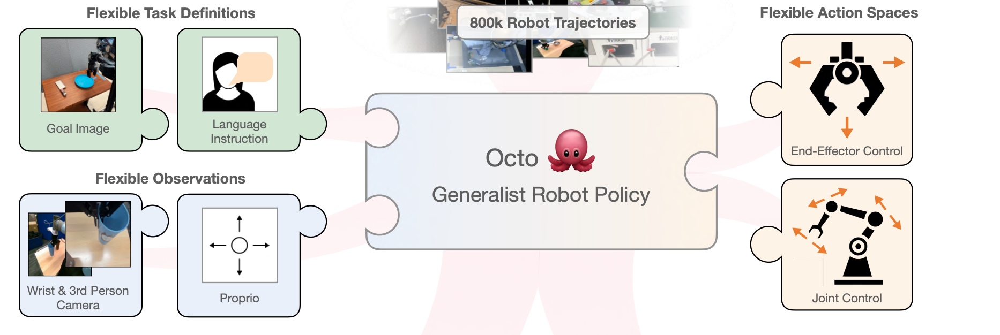
</column>
<column width-ratio="0.355707">
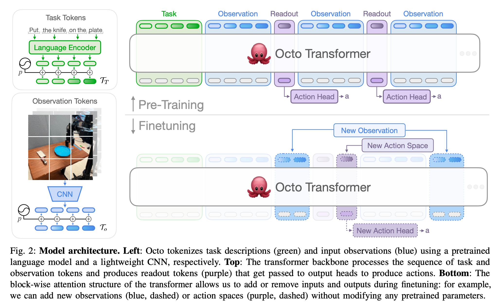
</column>
</grid>

- 数据

  - Open-X-Embodiment
- 模型

  - 纯transformed-based，相比VLM参数量小的多
  - language：T5-base（https://github.com/google-research/text-to-text-transfer-transformer）111M
  - Vision：light cnn
  - Action head: diffusion policy,  action chunk
  
    - 出多步的 action，代码提供了两种模式 RHC & TemporalEnsemble，前者执行前面的N步（预测16步走8步）再重新预测下面的动作，后者会融合之前动作（后8步）+最新观测（前8步）后输出实际动作
  - 执行逻辑：https://github.com/octo-models/octo/blob/main/octo/model/octo_model.py#L174 
- Multimodal fusion

  - Instruction: 对应上图的task token；
  - Observation：images + ego state（关节状态）；
  
    - 所有观测 token在attention中都会被concate 后用full attention（default, you can use causal mask if want）
    - https://github.com/octo-models/octo/blob/241fb3514b7c40957a86d869fecb7c7fc353f540/octo/model/components/block_transformer.py#L220
  - Instruction 和 obersvation 之间的融合
  
    - Attention 是一个按照时序排的causal mask, instruction给的是timestamp是-1，默认情况大概是一个这样的图
    - 任务→任务：全连接（在 timestep=-1 下等价于全连接）
    - 观测→任务/观测：因果（同步或过去）；任务→观测：不允许 
    - 这里每个task或者obs可以看成一个group，group组间（in tokenizer.py）和组内（AttentionRule）的attention都可定制
  - 在 提到，这是串联的方式，并联的方式就是pi系列，后面会提到这两的差异

  
- 训练 & 推理 

  - 除了T5-base有pretrain，其他都train-from-scratch
  - 两个stage：pretrain + finetune，finetune （sample 100 trajs）针对特定机器人 & 场景 ；更多超参在代码里
  - 256x256 3rd cam, 128x128 wrist cam(no random crop),  zero action
  - 训练流程：https://github.com/octo-models/octo/blob/main/scripts/train.py
  
    - demo的代码，基本没啥模块化
  - 真机推理code: https://github.com/octo-models/octo/blob/main/examples/04_eval_finetuned_on_robot.pyAction fetch：
  
    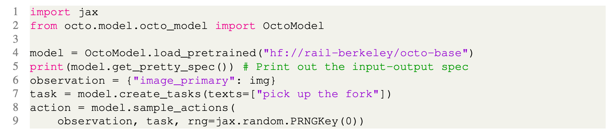
- Throught

  - 泛化性不够，vision+text 模块比较小，易过拟合
  - octo language表征其实很弱，只包含任务标签，不太能理解复杂的指令

## OpenVLA

https://arxiv.org/pdf/2406.09246

https://github.com/openvla/openvla

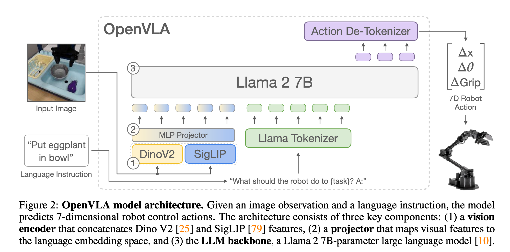

- 数据

  - Open-X-Embodiment
- 模型

  - 基座：Prismatic 7B https://github.com/TRI-ML/prismatic-vlms  
  
    - vision：DinoV2 + SigLip 构成，LLM： LLama2-7B；
    - model.py: https://github.com/openvla/openvla/blob/main/prismatic/models/vlas/openvla.py
  - Action
  
    - Tokenizer:  用 llm  vocab 中最少用的256个作为action token；
    
      - 没有action的special token，直接用下面的方式标记动作开始；主要是不太想改vlm词表表达，Prismatic在 <BOS> 之后直接拼接视觉 patch 的嵌入，不用 <IMAGE_START>/<IMAGE_END> 等文本特殊词
  
    ```Python
            self.action_token_begin_idx: int = int(self.tokenizer.vocab_size - (self.n_bins + 1))
    ```
- Multimodal fusion

  - 和prismatic 的拼法一致，<BOS> + [vision  embedings] + [text embeddings] ，没有本体status 

  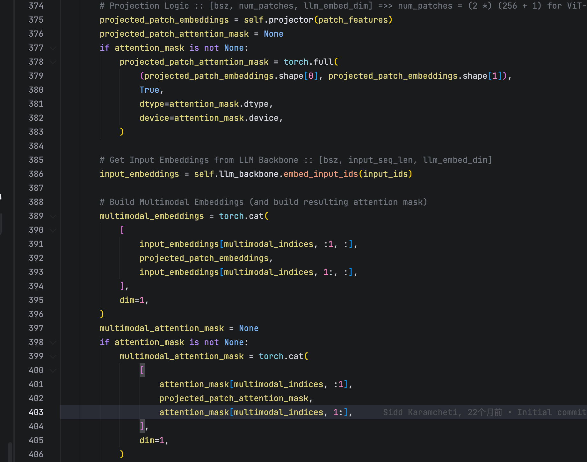
- 训练 & 推理

  - 两阶段训练：全参数微调 + lora
  - 224x224px; tune vision encoder;  分辨率压的挺低的；
  - 训练代码流程：https://github.com/openvla/openvla/blob/main/vla-scripts/train.py
  
    - 仅支持 fsdp & ddp ，做了部分模块化
  
    
  - 部署代码：https://github.com/openvla/openvla/blob/main/vla-scripts/deploy.py
  
    - REST 服务，based on FastAPI , 用json传递模型输出的action
    - 单步推理，只执行一轮，如果是一个50步的轨迹，会推50次，不如diffusion来的爽快
- Thought

  - image token 需要先固定长度，不好做 dynamic resolution

## CogACT

A Foundational Vision-Language-Action Model for Synergizing Cognition and Action in Robotic Manipulation

https://cogact.github.io/CogACT_paper.pdf

https://github.com/microsoft/CogACT

<grid>
<column width-ratio="0.662734">
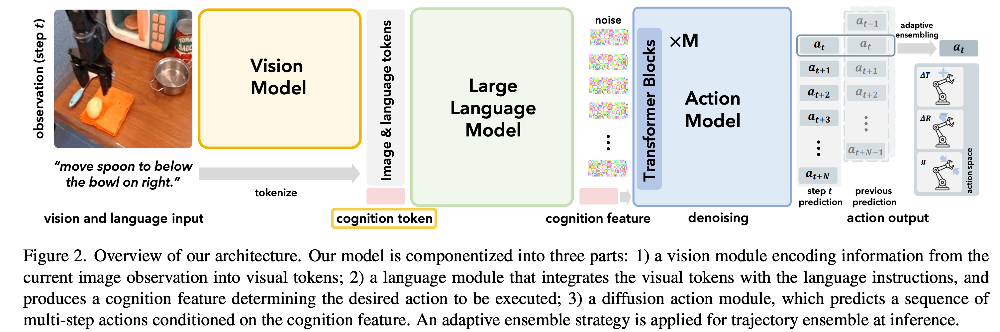
</column>
<column width-ratio="0.337266">
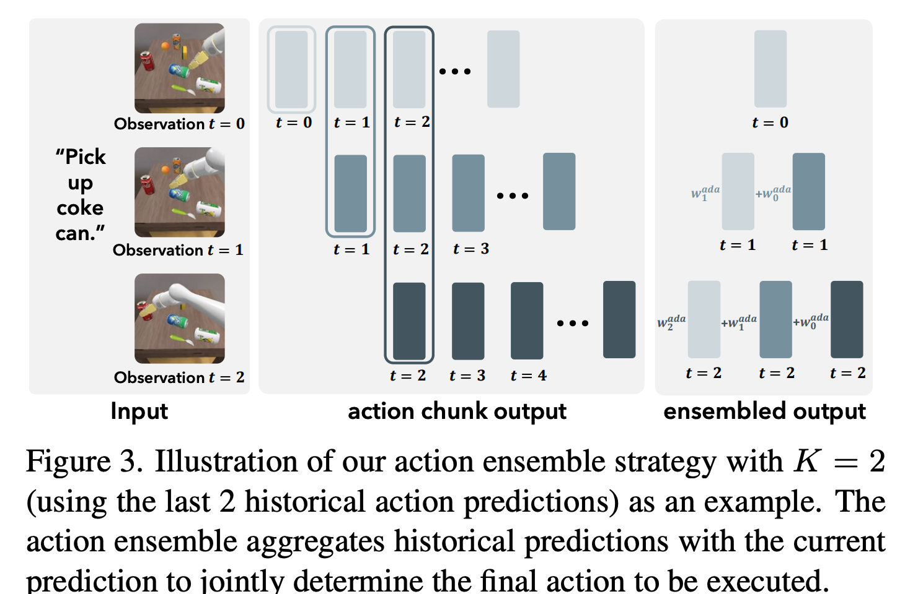
</column>
</grid>

- 数据

  > 0.4 million robot trajectories containing 22.5 million frames as our training data

  - Open-X-Embodiment
- 模型

  - Dual system
  - 类似 openvla，但是action head 用了 DiT，不是直接vlm后直接解码action
  - vision
  
    - DINOv2 + SigLIP，concat 
    - 固定 image token 数
  - language： llama 2
  - Action：DiT with diffusion policy，动作在输出的时候会 ensemble，weights用过cos similarity得到
  - 关于 cognition features 在代码形式上可能更好理解，对vlm的输出做了简单的压缩，压缩的特征会和图文更一致；

  <grid>
  <column width-ratio="0.443030">
  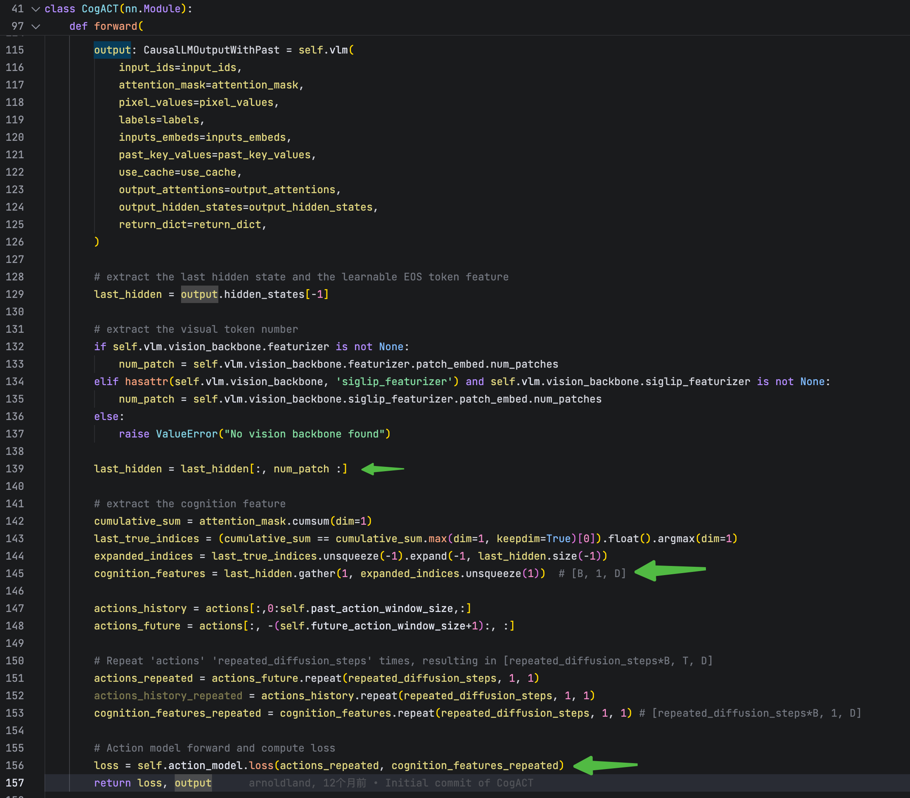
  </column>
  <column width-ratio="0.556970">
  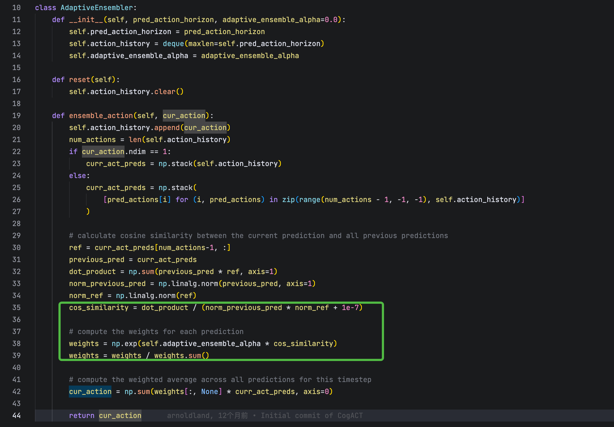
  </column>
  </grid>
- Multimodal fusion

  - 和 openvla 一样
- 训练 & 推理

  - 从风格看，代码大概率是基于openvla改的
  - https://github.com/microsoft/CogACT/blob/main/scripts/train.py
  - https://github.com/microsoft/CogACT/blob/main/scripts/deploy.py

## 总结

2024开始，一些工作已经逐渐吃上VLM的红利，2025则是大爆发，各家推出自己的VLA 架构 & 数据，尝试在一些任务出活。

# 2025

2025年的架构基本都是上述的形式。不同主要集中在：

- 数据
- 训练方式

## Intern 系列

### InternVLA-M1: 空间引导的通用机器人策略

- **论文**: [InternVLA-M1: A Spatially Guided Vision-Language-Action Framework for Generalist Robot Policy](https://arxiv.org/pdf/2510.13778)
- **仓库**: [InternRobotics/InternVLA-M1](https://github.com/InternRobotics/InternVLA-M1)

InternVLA-M1 是由商汤科技团队推出的一个 VLA 框架，其核心亮点在于通过**精细的数据工程和训练策略**，来着重增强 VLM 对物理世界的**空间感知 (Spatial Grounding)** 能力。

<grid>
<column width-ratio="0.509696">
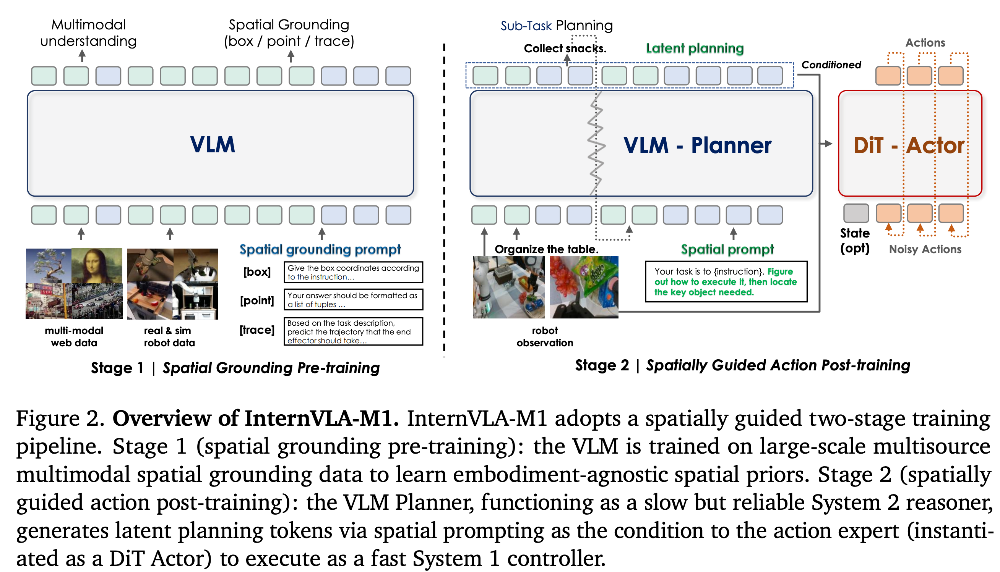
</column>
<column width-ratio="0.490304">
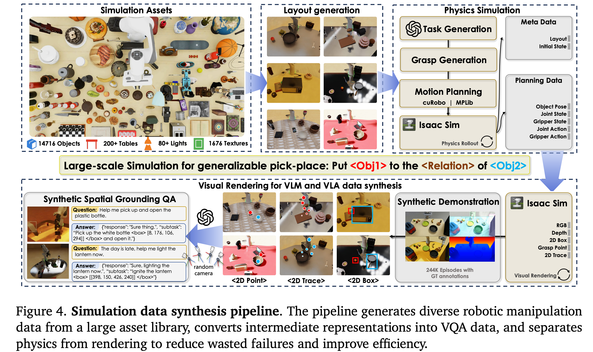
</column>
</grid>

- **数据**InternVLA-M1 的训练过程被精心设计为三个阶段，每个阶段都使用了不同类型的数据：

  1. **空间感知预训练 (Spatial-Grounding Pre-training)**:
  
     - **目标**: 提升 VLM 的空间理解能力。
     - **数据**: 使用了多种包含了丰富空间信息的问答 (QA) 数据集，例如：
     
       - **通用 QA**: LLaVA-OneVision, InternVL3
       - **框选 QA (Box QA)**: RefCOCO, COCO-ReM
       - **轨迹 QA (Trajectory QA)**: A0 ManiSkill 子集
       - **点位 QA (Point QA)**: Pixmo-Points, RoboPoint
     - 此外，团队还构建并使用了自有的 **InternData-M1** 数据集。
  2. **动作预对齐 (Action Post-Pre-training)**:
  
     - **目标**: 利用大规模仿真数据，初步对齐 VLM 的“规划”和 Action Expert 的“执行”。
     - **数据**: 使用了 24.4 万条在仿真环境中生成的闭环样本。
  3. **现实世界对齐 (Action Post-training)**:
  
     - **目标**: 在真实世界数据上进行最终的联合训练和微调。align 真实世界
     - **数据**:
     
       - 主要使用 **OXE** 数据集。
       - 引入了 **指令重写 (Instruction Rewriting)** 。例如，将简单的指令 `“把所有玩具放进玩具箱”` 扩充为 `“识别所有相关的玩具以及它们与容器的空间关系”`，从而引导 VLM 更加关注空间信息。
       - 训练方式是 **联合训练 (Co-training)**，即将 OXE 数据和第一阶段的空间感知数据混合在一起进行训练。
- **模型架构**InternVLA-M1 同样采用了 **双系统 (Dual-System)** 架构：

  - **VLM**: 基于 **Qwen2.5VL-3B** 进行微调。
  - **Action Expert**:
  
    - DiT (Diffusion Transformer)
    - **拥有自己独立的视觉编码器 DINOv2**
- **多模态融合**

  - 串联的形式，只拿了VLM输出的最后一层作为condition 给DiT
- 训练 & 推理

  - 联合训练，上面说的co-train，对vlm部分的gradient 做了衰减，避免co-train对vlm造成比较大的影响，这个也没找到w/wo decay 的影响
  - 训练时的spatial prompt在config中配置
  
    - 这里的cot包含了对场景的描述，用于辅助vlm做空间感知

  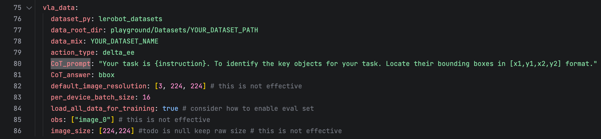

  - 真机部署代码：https://github.com/InternRobotics/InternVLA-M1/blob/InternVLA-M1/examples/real_robot/controller_dual.py
- **思考与小结**

  - InternVLA-M1 的核心贡献在于其系统化的数据工程，清晰展示了如何通过多阶段、多任务的训练来为 VLM 注入关键的物理世界空间感知能力。
  - 对于为什么没有采用 Flow Matching 而是沿用了 Diffusion Policy，根据与作者的交流，主要是因为在早期实验中，更换为 Flow Matching 并未带来显著性能提升，或许在当前阶段，**模型架构本身可能不是唯一的瓶颈，数据和训练策略更为重要**

<grid>
<column width-ratio="0.676420">
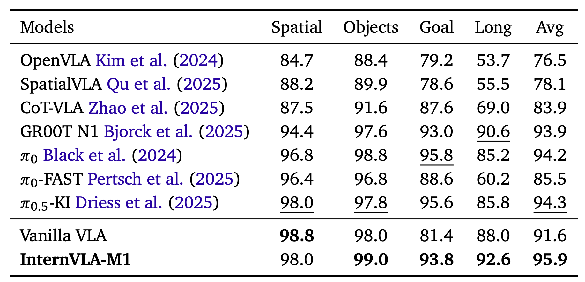
</column>
<column width-ratio="0.323580">
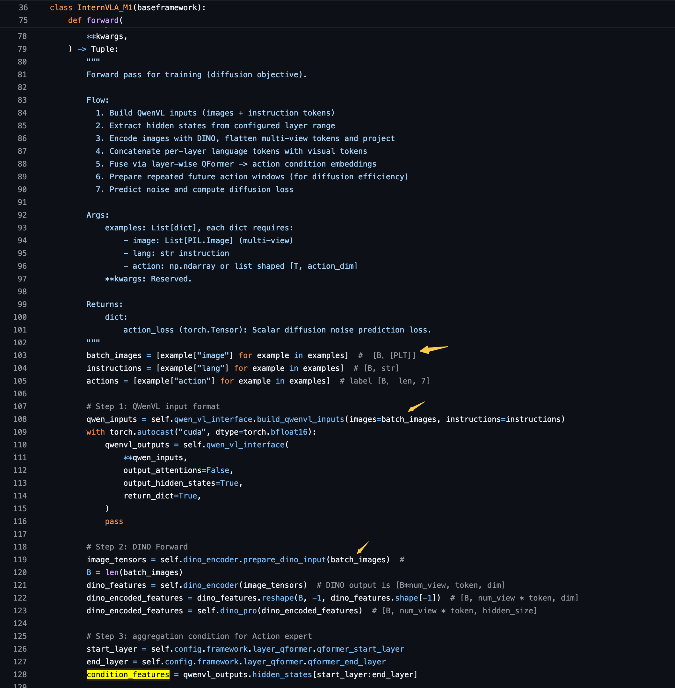
</column>
</grid>

## GR00T 系列: NVIDIA 的机器人基础模型

### **GR00T-N1**

https://arxiv.org/pdf/2503.14734

https://github.com/NVIDIA/Isaac-GR00T/tree/main、

<grid>
<column width-ratio="0.547001">
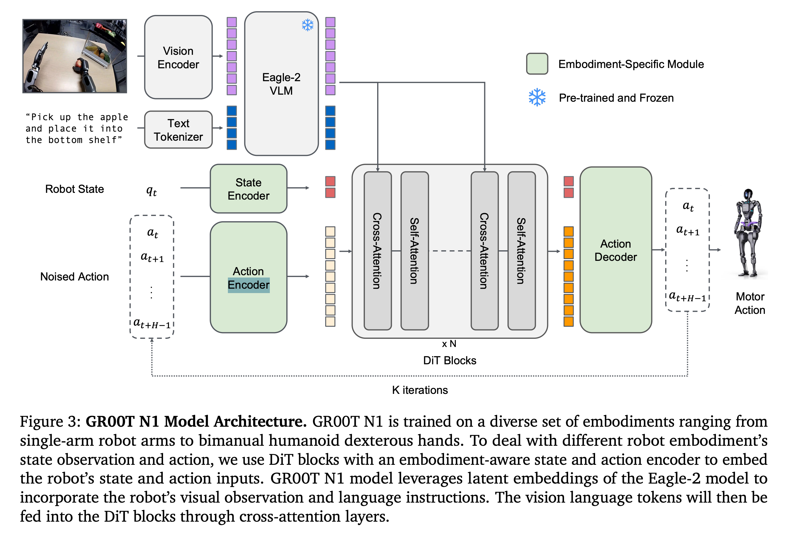
</column>
<column width-ratio="0.452999">
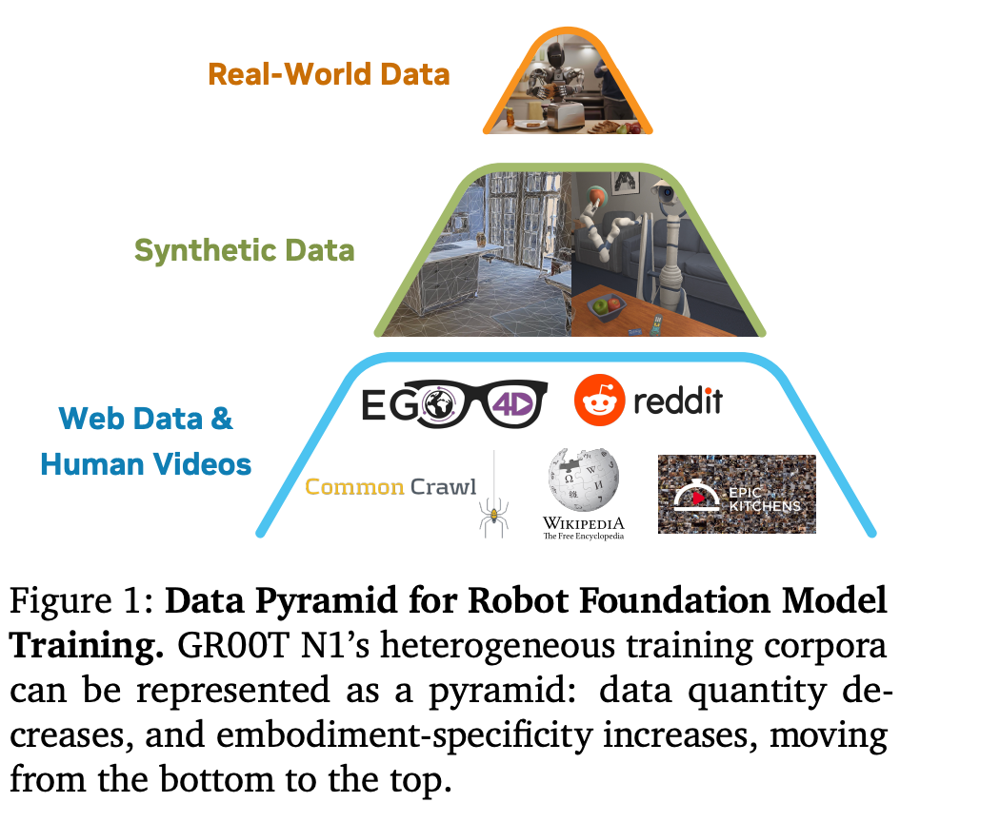
</column>
</grid>

- **数据**

  - **真实世界数据**:
  
    - 整合了 **Open X-Embodiment** 和 **AgiBot-Alpha** 等公开数据集。
    - 包含了基于傅里叶 GR-1 人形机器人采集的数据。
  - **仿真与生成数据**: 这是 GR00T 的一大特色，它严重依赖仿真环境和数据生成技术来扩大训练规模。
- 模型架构

GR00T-N1 总参数量约为 2.2B，其中 VLM 占 1.34B。

- LAPA：https://arxiv.org/pdf/2410.11758 N1 使用LAPA对缺乏action数据做标签的生成，它不属于N1的模型架构，但是 N1 会基于 LAPA 做一些伪标签

  <grid>
  <column width-ratio="0.703332">
  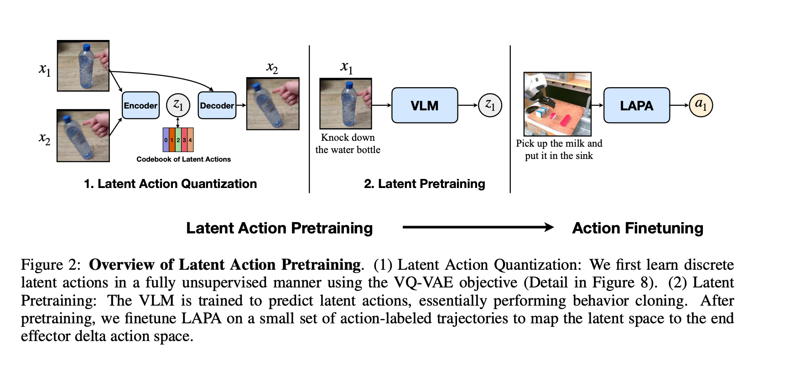
  </column>
  <column width-ratio="0.296668">
  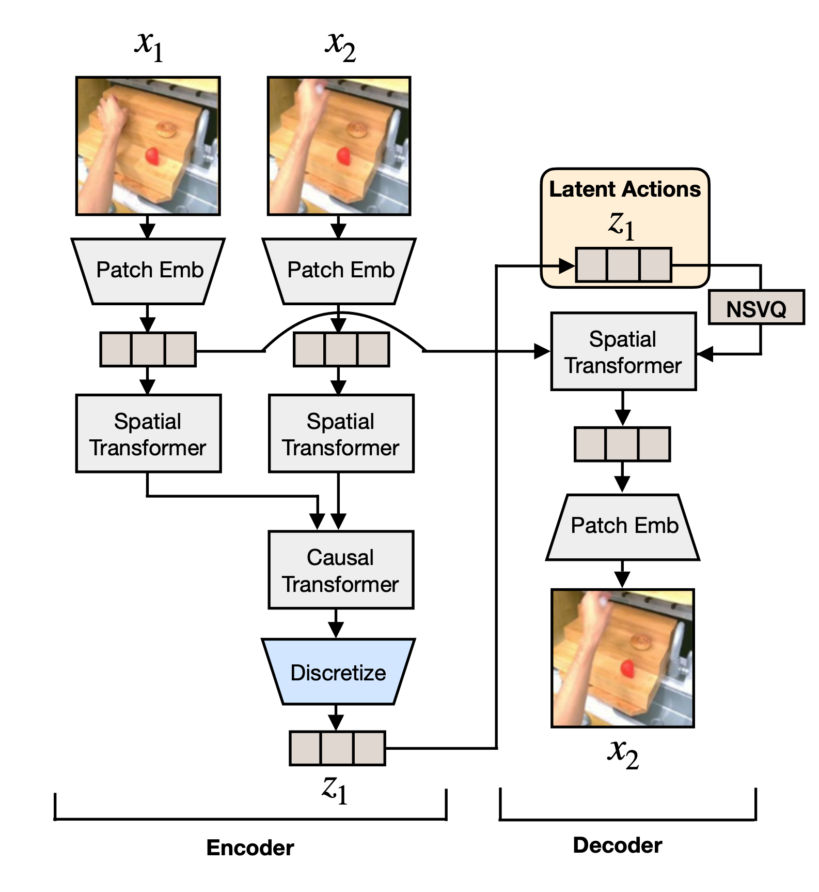
  </column>
  </grid>

  - 分三步训练，第一步训练VQVAE，学习表征 latent action；输入时前后两张图x1,x2. 输出是x2，中间有个表征，称之为latent action (你就认为它是个action的高维表征形式吧)
  - 第二步训练VLM，让VLM对x1可以输出latent action，VLM会结一个简单的mlp head（这里label猜测是VQVAE在线生成的）
  - 第三步训练 LAPA，基于一些有action的数据微调，上一步的mlp head会换成action head 
  - 本质上根据海量web视频学习物理规律，再基于此输出机器人的动作
- Action Head

  - State encoder & Action encoder & Action decoder： MLP
  -  DiT: alternating cross-attention and self-attention 
- VLM：  NVIDIA Eagle-2 VLM https://arxiv.org/pdf/2501.14818

  - N1 在训练时 LM 部分参数不更新，但是vision encoder 会更新；
  - 更多数据训练：ScienceQA，VQA，OCR，等等
  - Vision：
  
    - AnyRes: random crop + global image
    
      - 走的 llava 那一套，和 navit 不一样
    - Extract feature: SigLIP + PixelShuffle & ConvNeXt
  - Language：虽然文中用的qwen2.5 也可以换成其他的；

  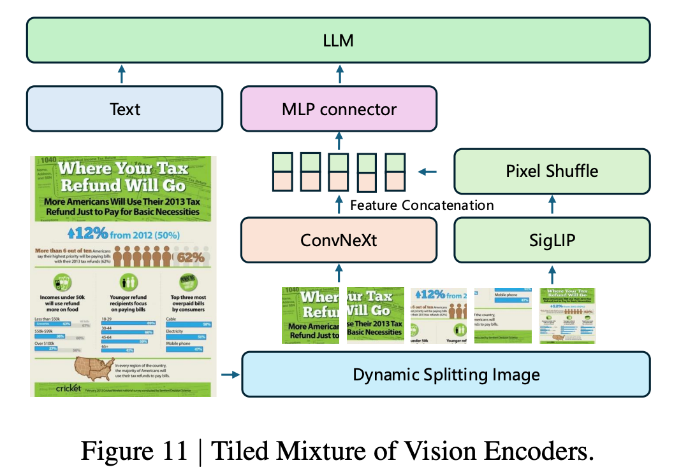
- **训练与推理**

  - **预训练 (Pre-training)**:**数据**: 主要使用大规模的人类第一视角视频数据 (human egocentric video)，动作标签由 LAPA 或逆动力学模型 (IDM) 生成。
  - **后训练 (Post-training)**:
  
    - 真机数据，和其他方法没区别
    - **Neural Trajectories**
    
      - 利用世界模型 (World Model) 和仿真环境，闭环大规模地生成训练数据。
      - **流程**:
      
        1. 给定一个新的指令。
        2. **世界模型** 预测出在该指令下，未来一系列的图像会是什么样。
        3. **LAPA 或 IDM** 根据这些预测出的未来图像，反向计算出对应的动作标签。
        4. VLA 模型根据指令输出动作，并与生成的伪标签计算损失。

  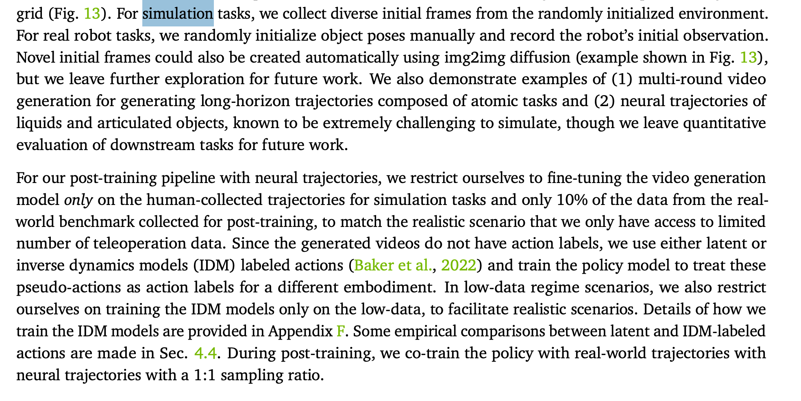

  - **推理**
  
    - 根据官方提供的 notebook，在 L40 GPU 上使用 bf16 精度，N1 模型采样一个包含 16 步的动作块耗时约 **63.9ms**。
  - 代码
  
    - 训练：https://github.com/NVIDIA/Isaac-GR00T/blob/main/scripts/gr00t_finetune.py
    - 推理：https://github.com/NVIDIA/Isaac-GR00T/blob/n1.5-release/scripts/inference_service.py
    - 速度对比：https://github.com/NVIDIA/Isaac-GR00T/blob/main/scripts/deployment/GR00T_inference_timing.ipynb
    
      - Torch eager mode / torch.compile / tensorrt; GR00T 用torch.compile & trt （dtype: bf16）自带的一些优化实现了两倍加速
    
      <grid>
      <column width-ratio="0.792098">
      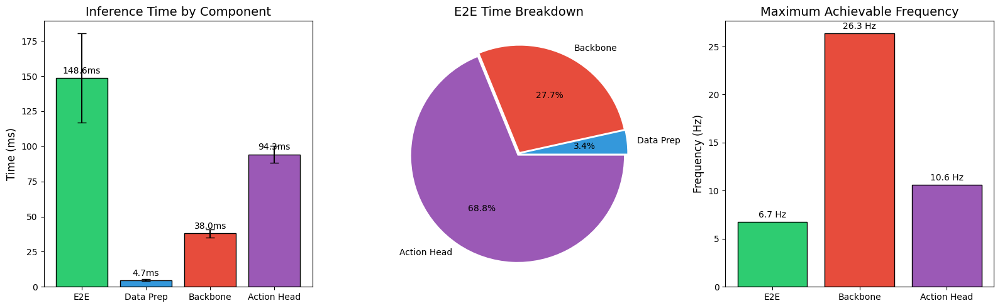
      </column>
      <column width-ratio="0.207902">
      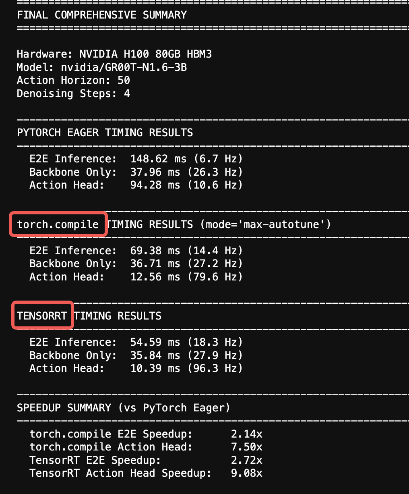
      </column>
      </grid>

### **GR00T-N1.5**

- **博客**: [NVIDIA Research Blog on N1.5](https://research.nvidia.com/labs/gear/gr00t-n1_5/)

N1.5 是 N1 的一个轻量化和工程优化版本，核心变化在于：

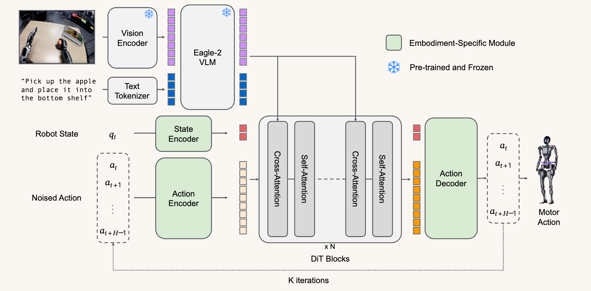

- **VLM 完全冻结**: 在 N1 中，视觉编码器是参与训练的。而在 N1.5 中，**整个 VLM (System 2) 都被冻结**，不再更新。这使得训练和部署变得更加简单高效，非常有利于工程化落地。
- **引入 FLARE 技术**: 在动作损失函数中，加入了一种名为 **FLARE** 的技术。其思想是：在训练 DiT 时，额外引入 VLM 预测的“未来”的 latent action 作为监督信号，期望 DiT 在生成当前动作时能“高瞻远瞩”，考虑到未来的图像变化。不过，这个技术似乎比较 tricky，在后续的 N1.6 版本中已被移除。

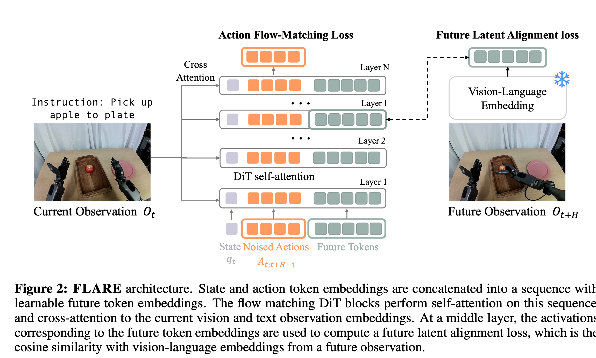

### **GR00T-N1.6**

N1.6 则是在模型性能上的又一次迭代：

- **更换基座**: 使用了基于 **Cosmos** 的、更强大的生成模型。
- **更大的 Action Head**: 对 Action Expert 部分进行了扩容。
- 不完全freeze VLM

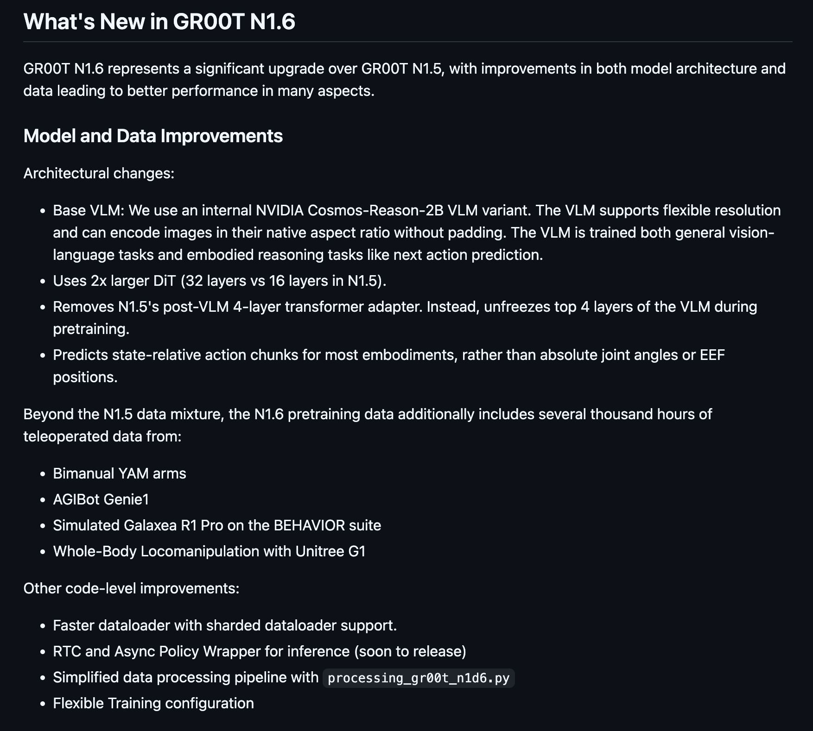

### **系列小结**

- **模块化与可插拔**: 整个 VLA 框架由多个可独立升级的模块（VLM, Action Head, LAPA, FLARE 等）组成。当某个领域出现更好的基座模型（如 Cosmos）或更好的技术（如 Flow Matching）时，NVIDIA 会迅速将其整合进 GR00T 框架。
- **仿真驱动**:  相比依赖昂贵的真实世界数据，GR00T 的核心 scaling law 建立在 **仿真** 之上，通过大规模生成数据来提升模型能力，再用少量真机数据进行校准

## PI series

Blog: 

https://www.physicalintelligence.company/blog

Code: 

https://github.com/Physical-Intelligence/openpi

Paper: 

https://www.physicalintelligence.company/download/pi0.pdf

https://arxiv.org/pdf/2504.16054 pi-0.5

https://www.physicalintelligence.company/download/pi05_KI.pdf 

https://arxiv.org/abs/2511.14759 pi-0.6

**总结：**

- 整个系列数据一直在做增量，multimodal fusion 的方式保持不变，训练范式在不断改进
- PI0: VLM+Action Experts CoTrain，针对难场景再 finetune
- PI0-FAST在PI0的基础上，用了FAST Tokenizer，更好的对齐VLM 和 expert的action latent space，vlm + expert一起训练
- PI0.5 在PI0-FAST的基础上，用了两阶段的训练方式，第一阶段基于FAST Tokenizer 只训练VLM，第二阶段只训练experts；
- PI-0.5KI 在PI0.5的基础上，用一阶段的训练方式，使用detach的方式，避免expert训练影响vlm原本的能力；只是训练方式的差异，计算图这些都是一毛一样的
- PI-0.6 在 PI0.5 的基础上接着训练，但把 VLM & Experts的模型变大了；并且改进目前 RL 训练的一些问题，取得更好的真机效果，这些问题包括：怎么设计可扩展、稳定的 RL方法，如何整合不同源（遥操/rollout/专家干预，内部也叫dagger）的数据；

<table><tbody><tr><td>model</td><td>data</td><td>architecture</td><td>multimodal fusion</td><td>训练 &amp; 推理</td><td>Thoughts</td></tr><tr><td>pi-0</td><td><ul><li>Open-X-Embodiment</li><li>Bridge v2</li><li>DROID</li><li>Custom Data（91%)<ul><li>68 task  with different robots</li><li>903M timesteps (797+106)<ul><li>不同robot 控制频率不同，按照50hz的算，包含5k小时的数据</li></ul></li><li>难任务数据多，task data weight n^0.43 缓解不平衡 ，n是样本数量</li></ul></li></ul></td><td><ul><li>VLM: paligemma 3B<ul><li>Vision encoder： SigLIP 400M</li></ul></li><li>Action <ul><li>Gemma expert 300M + flow matching</li><li>编码：mlp 编，mlp 解</li></ul></li></ul></td><td><ul><li>并联 attention<ul><li>vlm 部分没变，expert query vlm 的 kv</li><li>Expert inputs: action + ego states </li></ul></li></ul><br/> </td><td><ul><li>训练<ul><li>大部分场景直接用微调后的vlm+action head </li><li>难场景再针对数据 post-train</li></ul></li><li>Eval 场景<ul><li>叠衣服，简易桌面清理，复杂桌面清理，杂货装袋，取吐司；</li><li>语言指令场景：清理桌面，摆餐桌，装杂货；涉及人机交互；数据会做分步语言指令标注</li><li>新的灵巧任务：叠碗，叠毛巾，微波炉放保鲜盒、换纸巾卷、抽屉装东西；看泛化</li></ul></li><li>一些结论<ul><li>VLM的预训练权重是有用的，对比pi0-small，pi0听得懂人话</li></ul></li></ul></td><td><ul><li>针对难场景需要特定post-training，很难scaling-up，对场景理解能力不够</li></ul>

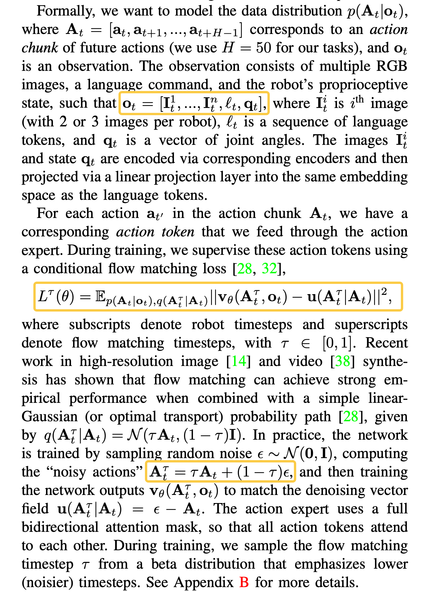

</td></tr><tr><td>pi-0.5</td><td>+ more data<ul><li>Diverse Mobile Manipulator data<ul><li>400 h 家务数据</li></ul></li><li>Diverse Multi-Environment non-mobile robot data<ul><li>单臂 &amp; 双臂数据</li></ul></li><li>Cross-Embodiment laboratory data<ul><li>Open-x 的拓展版本</li></ul></li><li>标注subtask<ul><li>解决长程任务</li></ul></li><li>Multi-modal Web Data <ul><li>detection，QA，VQA，localization </li></ul></li></ul></td><td><ul><li>VLM：如上</li><li>Action：改了编码方式 &amp; 训练方式<ul><li>Pretrain:<b> FAST tokenizer</b> + CE loss</li><li>Post-Train: <b>MLP</b> + Action Expert + flow matching</li><li>FAST tokenizer：DCT + BPE，时域转频域再丢高频噪声，作用 原本50个步长的动作可以压缩到5-10个token；作用在label上</li></ul></li></ul></td><td><ul><li>并联attention<ul><li>expert的输入不再需要ego states</li></ul></li></ul></td><td><ul><li>训练<ul><li>Pretrain<ul><li>VLM-only</li><li>Action数据也也一起训练</li><li>有更多数据，提高VLM感知能力 </li></ul></li><li>Post-train<ul><li>Freeze VLM，Action-only</li><li>提高对具体任务的操作能力</li></ul></li></ul></li></ul></td><td><ul><li>和pi0的不同<ul><li>Formula: pi0是直接出action chunk，pi0.5会对用户指令拆解</li></ul></li></ul>

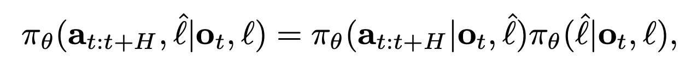

<ul><li> diverse tasks 的数据比较重要</li><li>pi0+FAST+flow 的形式很接近pi0.5，FAST提供了ACTION和VL更好的编码形式，但可能还有改进空间？比如不同的任务动作的难度如何区分</li></ul><grid><column width-ratio="0.230940">

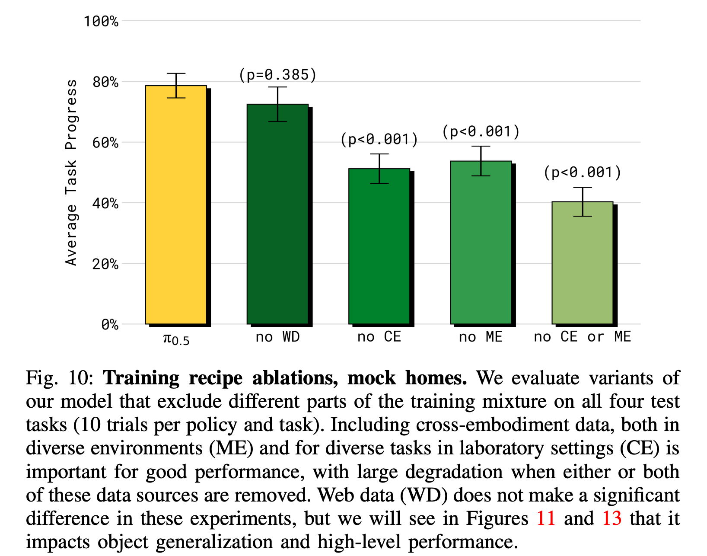

</column><column width-ratio="0.365458">

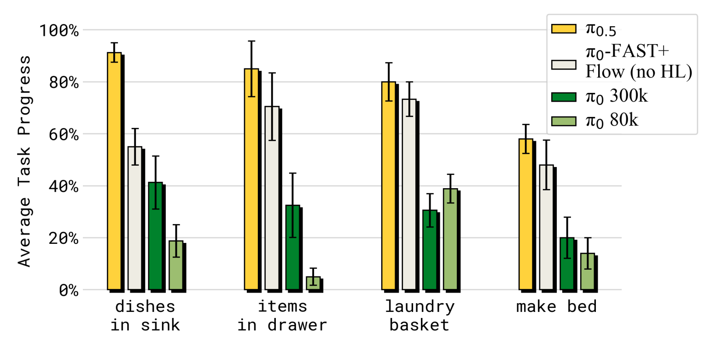

</column><column width-ratio="0.294401">

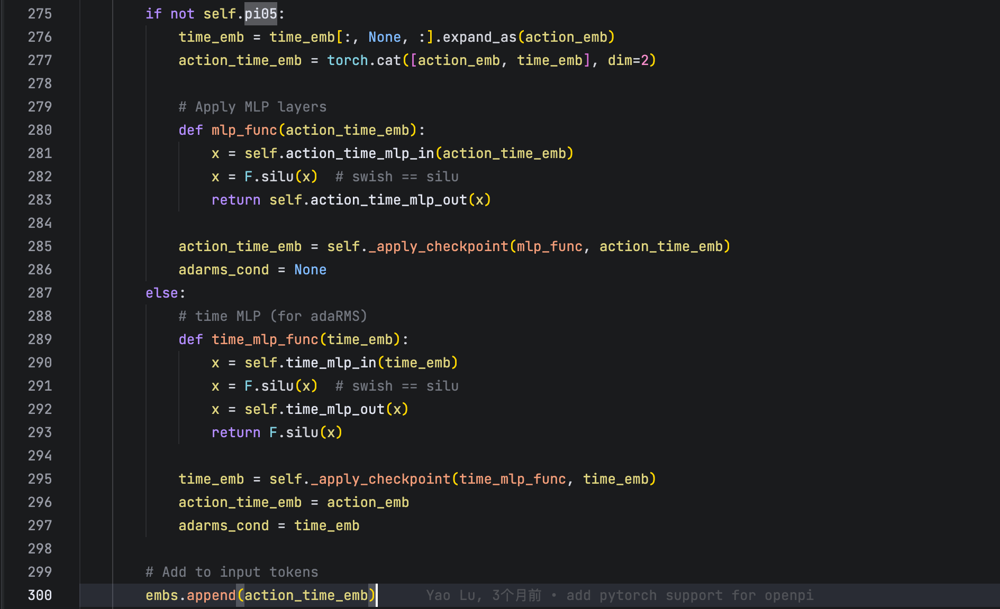

</column><column width-ratio="0.109201">

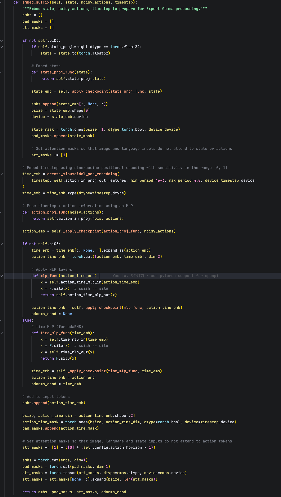

</column></grid><ul><li>代码记录<ul><li>https://github.com/Physical-Intelligence/openpi/blob/main/src/openpi/models_pytorch/pi0_pytorch.py#L237</li><li>pi0.5 不会把observe.states编码进VLM，pi0会</li><li> expert 的 AdaNorm 会把 timestep embed 作为condition，pi0 则是直接和 action embed 拼一起 ，cond=None</li></ul><p></p></li></ul></td></tr><tr><td>pi-0.5 KI</td><td>pi-0.5 single-stage 版本<br/>所谓knowledge Insulating 就是右边的stop- gradient；训练action的时候不影响vlm的原本的性能；在pi-0.5 是通过two stage 训练实现类似的效果</td><td>

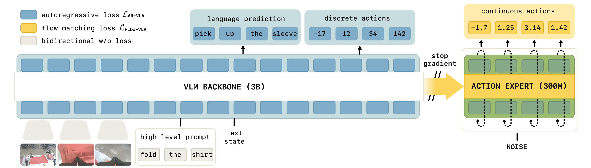

</td><td><ul><li>如上<ul><li>但做并联的时候，对于expert来说来自vlm的k v 会被detach</li></ul></li></ul></td><td><ul><li>训练<ul><li>只有一个stage，vlm和experts一起训练，但是知识虽然会从vlm流向expert但梯度回传的时候不影响VLM</li></ul></li></ul></td><td></td></tr><tr><td>pi-0.6</td><td>pi-0.5 RL 版本<br/>当可以评价当前状态的得分，就可以尽可能采样到好的动作<ul><li>轨迹包括<ul><li>自主探索数据</li><li>演示数据</li><li>专家干预数据</li></ul></li><li>状态利用value function来评估</li></ul><blockquote><p>虽然前面说了value function，这里还是补充一下：</p><p>RL里有一套 value-based 的方法，学习<b>评分函数</b> Q(s, a) 或 V(s),  执行动作时根据</p><p>$$Action=\arg\max_{a} Q(s, a)$$</p><p>来采样动作，V函数咋办呢，他只能评价，向左坏，向上也坏，向右还行；不知道怎么执行一个从坏到好的动作，此时会依赖一个环境模型来推演；比如，pi-0.6 用了vlm-policy 来进行推演，推演的办法就是把这个value function的结果变成token，让vlm输出，就变成了,这里的action sate就是value function的评价结果</p><p>$$Action= VLM(text, image, action\_state)$$</p></blockquote></td><td><ul><li>VLM：paligemma 5B</li><li>Action<ul><li>expert变成了 860M </li></ul></li><li>value function<ul><li>siglip 400M + gemma 270M</li></ul></li></ul>

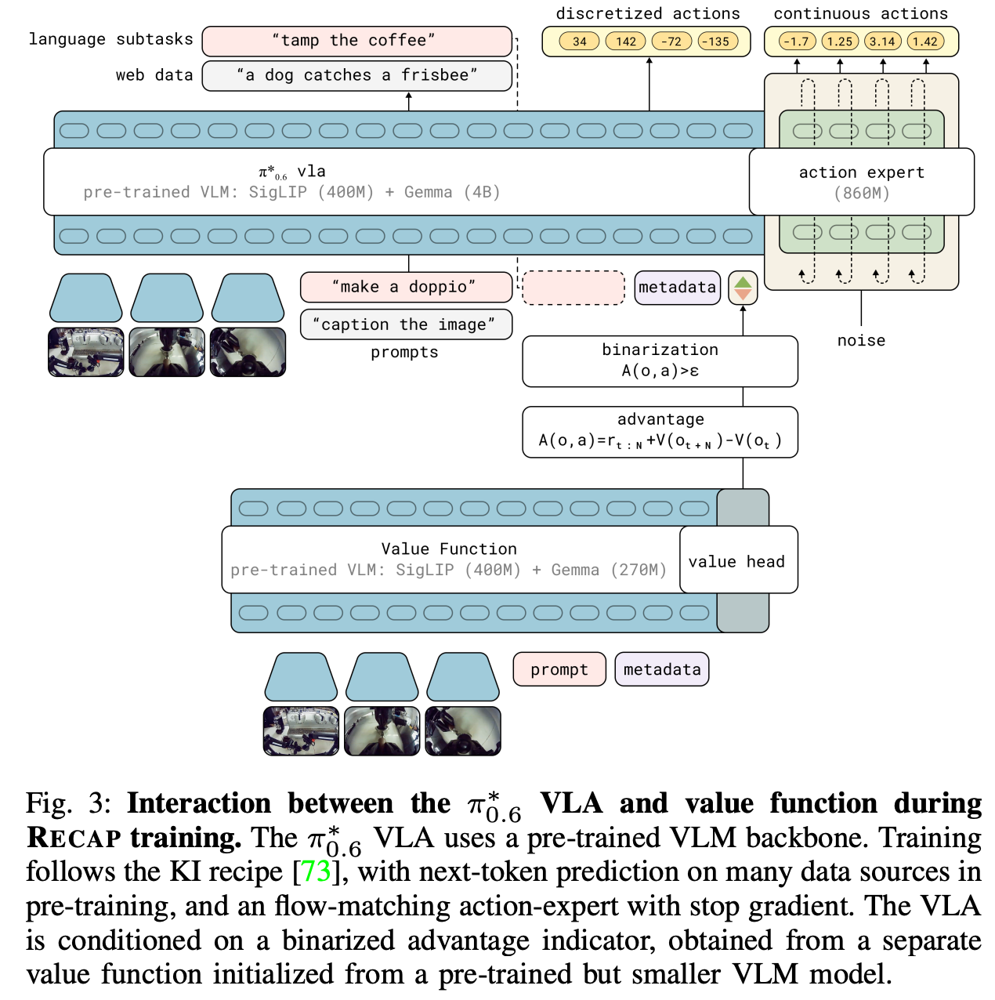

<blockquote><p>模型变猜测做了ablation study，</p><p>因为数据越来越多，3B表征可能不如 5B了，如果后续我们部署的模型也越来越大，应该怎么实现低延时的部署时需要提前考虑的问题</p></blockquote></td><td>如上<br/>插播一下value function的定义原文

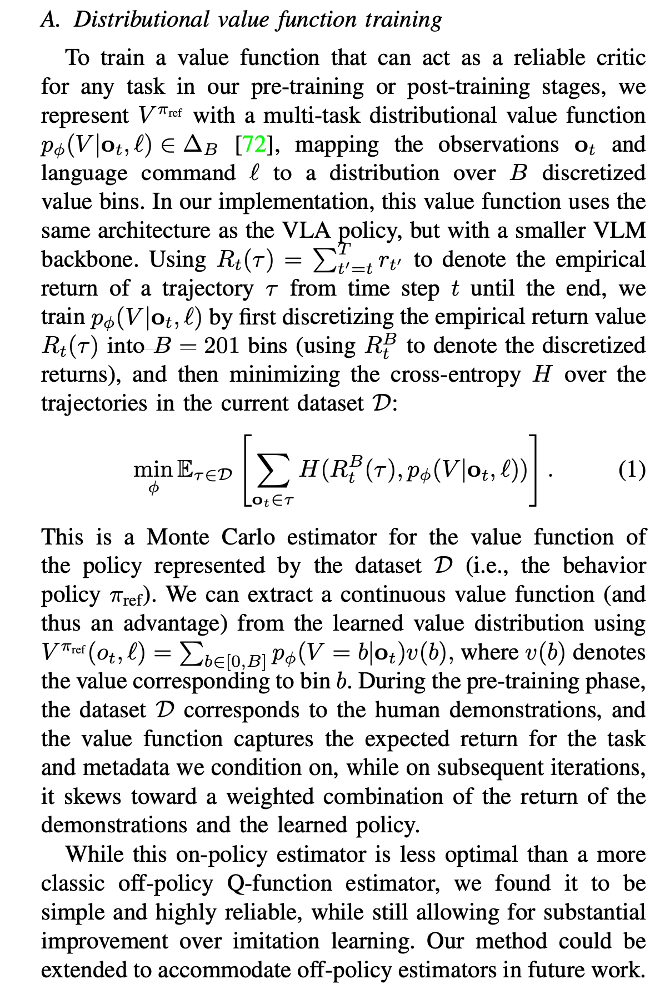

</td><td>额外多了<ul><li> value function的训练 <ul><li>划分bins，假设现在t=10，整体的成功的轨迹45，那么大概还有35步才能走完轨迹，此时 35 步对应的bin的概率最大</li><li>用交叉熵训练</li><li>value function有评估当前状态离成功还有多远</li></ul>

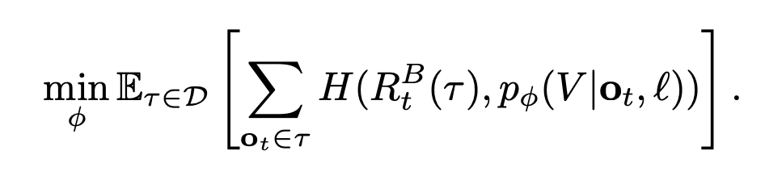

</li><li>value-function 到动作的转换<ul><li>价值网络转token：基于value function 来计算 advantage，如果大于阈值则标记 &lt;good_action&gt;, 否则则是 &lt;bad_action&gt; </li><li> P(Action | State, Action_State) 学习条件概率分布，即在给好的动作状态&lt;good_action&gt;下, vlm 学习他会对应什么样的动作，进而淘汰那些&lt;bad_action&gt;</li></ul></li><li>评估：prompt 就改成，xxx，请输出高质量动作；在上一步的学习中，已经让模型能够区分动作好坏；value function 在部署就不需要了；</li></ul></td><td><ul><li>记一下preliminaries<ul><li>Traj 和初始点，模型给出的轨迹以及执行轨迹后的观测有关</li></ul>

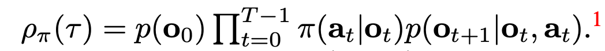

<ul><li>RL最大化轨迹期望，value function评价当前状态，</li></ul>

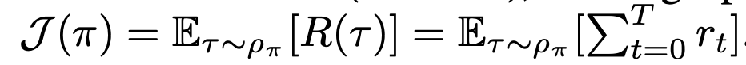

</li><li>为什么不用q-function 结合动作来评估当前状态？<ul><li> 如果用q-function就不是一个现在的多分类模型，会变成一个回归模型：当前状态下执行某种动作完成任务指令还有多少步才能成功；</li><li>这种还有多少步成功转换成token，不但还需要面临一次离散化，变成&lt;近期不可成功&gt;，&lt;中期可成功&gt;，&lt;长期可成功&gt;，&lt;算了吧，这个需求做不了&gt; 类似的prompt，而且还不如直接用value- function让vlm输出高于平均数值的动作</li></ul><p></p></li></ul></td></tr></tbody></table>

## GR series

https://arxiv.org/pdf/2312.13139   GR-1

https://arxiv.org/pdf/2410.06158  GR-2

https://arxiv.org/abs/2507.15493  GR-3

https://arxiv.org/pdf/2512.01801 GR-RL

codes：

https://github.com/bytedance/GR-1/blob/main/models/gr1.py 

<table><tbody><tr><td>model</td><td>data</td><td>architecture</td><td>multimodal fusion</td><td>训练 &amp; 推理</td><td>Thoughts</td></tr><tr><td>GR-1</td><td><ul><li>Large-Scale Video Dataset<ul><li>ego4d</li></ul></li><li>Real Robot Dataset</li></ul></td><td><ul><li>Language: CLIP</li><li>Vision: ViT pretrained with MAE +  Perceiver Resampler, reampler 会固定image token 长度为N，image尾部有特殊标识</li><li>Action<ul><li>MLP</li></ul><p></p></li></ul></td><td><ul><li>同一时刻下的，vision + text + state 是直接concat, 用下三角 mask 做attention</li><li>不同时刻，有时序关系，t+1 可以attend t，反之不行</li></ul></td><td><ul><li>训练<ul><li>分两步，第一步训视频预测网络，输入是过往观测+text；第二步训robot操作，</li></ul><grid><column width-ratio="0.346985">

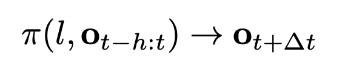

<p></p></column><column width-ratio="0.653015">

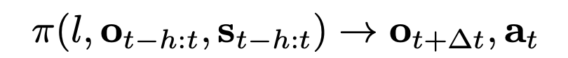

<p></p></column></grid><ul><li>ViT + Clip都是 forzen </li></ul></li><li>验证<ul><li>基于仿真</li></ul></li></ul></td><td><ul><li>验证了一个不错的idea：预测未来帧可以用来做机器人的动作规划（GR00T 其实也是类似的idea，GR-1的这个时间点早得多</li></ul>

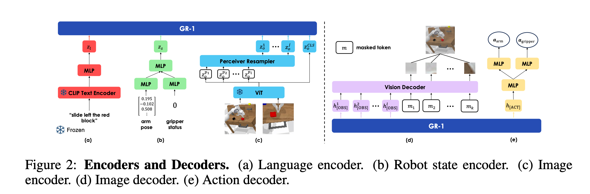

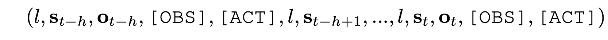

<ul><li>在第二阶段训练的时候，Text 会不断的和新观测重复，虽然是为了避免text稀释，但引入不必要的计算，以及不同的观测对应的text一样的似乎也不是很合适</li></ul></td></tr><tr><td>GR-2</td><td><ul><li>更多的数据 Web data （38M）</li></ul></td><td><ul><li>Vision：VQGAN</li><li>Language：CLIP</li><li>Action：cVAE<ul><li>用生成模型预测chunking </li></ul></li></ul></td><td>同上</td><td><ul><li>训练：<p>和GR-1一样都是两阶段训练：video generation pre-training and robot data fine-tuning.</p><p>stage1 &amp; 2 的目标</p>

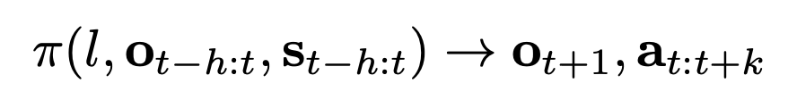

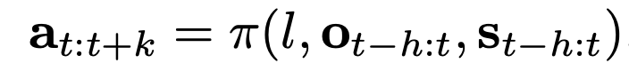

<p></p></li></ul></td><td><ul><li>Scaling GR-1 版本</li></ul></td></tr><tr><td>GR-3</td><td><ul><li>加入了 Pico data<ul><li>用人类手机的ego-center的数据来增强模型泛化</li></ul></li></ul></td><td><ul><li>VLM：qwen-3B</li><li>Action：DiT 1B</li></ul>

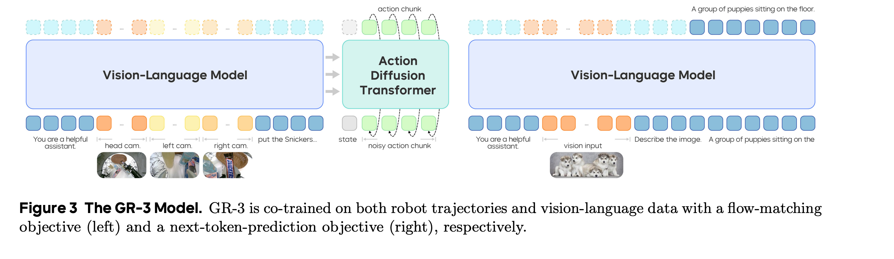

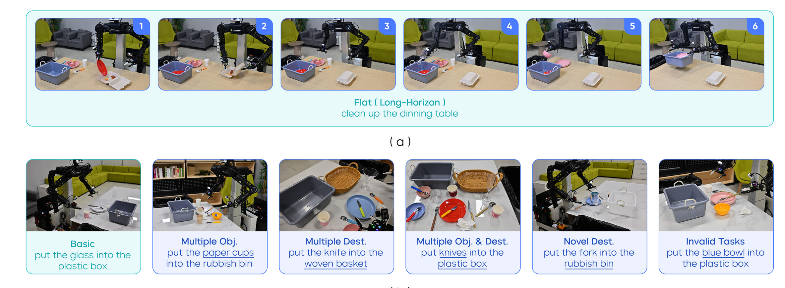

</td><td>同上</td><td><ul><li>训练<p>还是两阶段，但是第一阶段的目的发生变化，第一阶段加入了action co-train</p><ul><li>Co-train VLM + Action</li><li>用 pico+ 遥操 lora finetune </li></ul></li></ul></td><td><ul><li>亮点主要在于pico数据，其他的都是常规做法；</li><li>换成vlm的原因猜测是可能不需要再做大规模就可以吃点大数据的红利</li></ul></td></tr><tr><td>GR-RL</td><td>发现数据中有很多噪声，比如手抖，导致bc的时候也学习到这些没啥用的动作；</td><td>如上

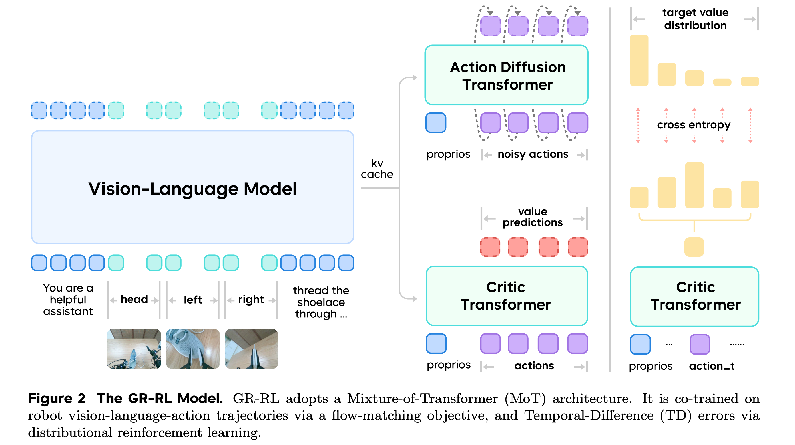

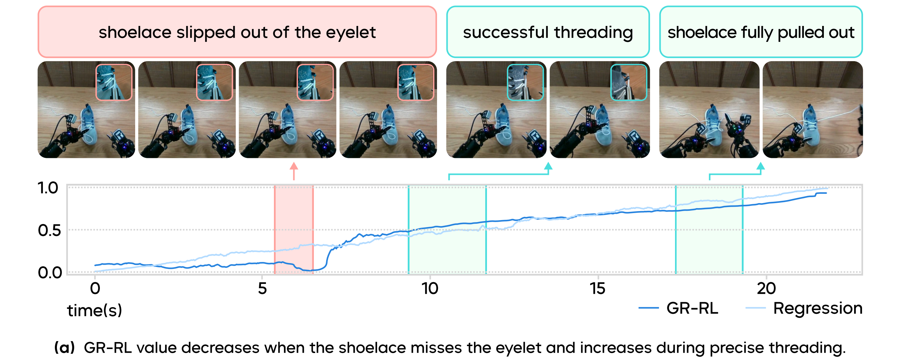

</td><td>如上</td><td><ul><li>主要是解决之前的两个问题：数据噪点，训练部署不一致；分别用了下面两个手段</li><li>offlineRL<ul><li>利用之前的数据训练Q(s,a|l) ，评估当前状态-动作对在完成任务过程中的“价值”或“进度”</li><li>基于Q剔除噪点数据</li></ul></li><li>onlineRL<ul><li>加入了新的交互数据训练</li><li>初始噪声会影响对动作生成：最合适的噪声是什么？也就是说，在当前环境下，给训练出来的模型啥样的输入它给的动作成功率会比较高</li><li>问题变成：“对动作的评价”转移为“对噪声的评价”，GR-RL引入了噪声预测器，以及一个critic 来评价噪声输出的好坏；训练方式是蒸馏</li></ul></li></ul></td><td>

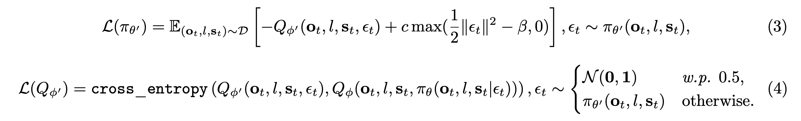

<ul><li>有两个critic，一个是基于policy &amp; 真实数据的critic （作为teacher），一个是用于评价噪声的crtic'（作为studndet），如果不这样做的话，动作的解码其实是个不可导的过程，critic没法直接作用到噪声预测上</li></ul></td></tr></tbody></table>

## GO-1

> 银河通用 AgiBot

https://arxiv.org/pdf/2503.06669 

https://github.com/OpenDriveLab/AgiBot-World

<grid>
<column width-ratio="0.669744">

</column>
<column width-ratio="0.330256">

</column>
</grid>

文章讲了数采流程，简单总结一下

- 和之前OXE的方式众包采集不同，AigBot都是同一个机型的数据，文章认为**数据在同一种机型下，更容易学习到事物规律**；
- AgiBot有比较大的数采平台，所以数据采集协议，规则制定这些 sop 都非常的重要
- 人机协同可以更高效采集

数据quality check ，如果这部分之后应该交给模型，能更快起量；

- 数据

  - AgiBot

- 模型 Vision-Language-Latent-Action (ViLLA) 

  - VLM: InternalVL
  - Action 
  
    - LAM encoder
- 训练 & 推理

  - 训练
  
    - stage1: 训练LAM , VQ-VAE 用于学习 latent action （类似LAPA里的做法）
    
      - 用大规模的 不同来源的 数据，学习 image -> action latent -> reconstruct image
    - stage2: 训练VLM 作为 latent planner （还是很像LAPA）
    
      - 上一步LAM有对image -> action latent 的编码能力，用这个作为伪标签训练 VLM，让VLM学习LAM 编码action的能力
    - stage3: 训练latent planner + action expert 
    
      - Latent planner 能把 vlm -> action latent ，action expert 则负责 action latent -> 物理空间连续的action
      - Action expert基于 InternLM2 构建，diffusion policy 训练
    - 总结：三个阶段训练完成 （text + image） -> vlm -> action latent -> action，和LAPA的范式非常像，主要差别是数据，还有模型选择；

## SmolVLA

> Huggingface 出品


https://arxiv.org/pdf/2506.01844

https://github.com/huggingface/VLAb

主打轻量化的VLA

- 数据

  - Task annotation with VLM：使用 Qwen2.5‑VL‑3B‑Instruct 自动生成 ≤30 字的任务描述，统一为动词开头的简短指令
  - 保留了image的order
  - HuggingFace 上公开的 481 个社区数据集，经过过滤后得到 22.9 k 轨迹、10.6 M 帧（约 23 k episodes）
- 模型

  - VLM:  SmolVLM-2 https://arxiv.org/pdf/2504.05299
  
    - Hugging face推出的轻量化VLM，主打video understanding
    - Vision encoder： SigLIP + pixel shuffle， 每个frame的image token 被限制在64
  - Action expert
  
    - 和vlm类似的一些结构，类似pi0的gemma expert
- Multimodal fusion

  - vlm会和expert之间信息传递；会有cross attention以及self attention，
  - cross attention：用action的q，来query VLM的KV
  - Self attention：拼接vlm的qkv，mask保证expert -> vlm , vlm -/-> expert
- 训练 & 推理

  - 训练
  
    - 两个stage训练：pretrain & finetune 
    - pretrain: vlm + action 
    - Finetune: vlm frozen ，finetune会针对使用仿真或者真机采集的数据
  - 异步推理，
  
    - 机器人采集 RGB 图像 + 状态信息，打包成 Observation 并发送至 Policy Server（GPU 端）
    - Policy Server 使用 SmolVLA 生成 长度为 k 的动作块（`a_{t:t+k-1}`），并返回给机器人
    - 机器人本地 Action Executor 按顺序执行收到的动作序列，同时 异步请求 下一块预测
    - 维护一个 动作队列长度阈值 g（如 g = 2k）。当队列长度 ≤ g 时，触发 新一次感知‑预测；否则继续执行现有动作，避免过多预测导致 资源浪费。（这个超参g是grid search搜索的
  
    <grid>
    <column width-ratio="0.553157">
    
    </column>
    <column width-ratio="0.446843">
    
    </column>
    </grid>

<grid>
<column width-ratio="0.610305">

</column>
<column width-ratio="0.389695">

</column>
</grid>

- Thoughts

  - smoVLA很容易过拟合到具体场景，可能对单一任务是来说效果还不错

## 总结

VLM+DiT已经被玩的差不多了，明年会不会是RL 元年呢 🤔

# Conclusion

1. 主流做法似乎都收敛到 VLM + DiT 的架构，主要在这几点有不同的改进方向：

   - 数据
   
     - 多用仿真数据
     
       - NV GR00T 系列
       - 只要 action 能在仿真数据中学的足够好，对真机数据的依赖就越少
     - 多用真机数据
     
       - PI 系列
       - 最接近使用场景的数据就是最好的，通过RL来逐渐减少采集量，让机器可用，商业化后能拿到更多的数据；参考自动驾驶L2
     - 更便宜的采集数据手段
     
       - 采集手套：Sunday ACT https://www.sunday.ai/journal/no-robot-data 没有相关文章放出来讲模型和训练是怎么做的，感觉比较关键的是从手套数据到本体的迁移，数据如何配比
       - VR & 智能眼镜 数据：硬件比如 pico, apple vision, meta & 小米的智能眼镜
       - UMI  https://github.com/real-stanford/universal_manipulation_interface?tab=readme-ov-file
       - human egocentric data: NV GR00T
   - Action编码
   
     - PI系列
     
       - 用FAST编码让VLM可以学习到action输出
       - 用expert query vlm's kv 的方式来让expert获取到一些图像+text的信息
     - 从海量数据中得到学习到一些运动规律，再基于此编码 Action，比如基于 world model 出 hiddent states / action
     
       - World model 直接出 action 的方案就可能不再是 VLM + DiT 的结构了，现阶段大家都用VLM是可能基于开源 & 已经经过了大量本文+图像数据训练
   - RL post-train
   
     - RECAP：PI-0.6
     
       - 状态评价其实非常难构造，但是pi0.6 提供了一种解决思路，对数据集的轨迹进行分类，从而从数据中学习到好的轨迹；目前有点像conditional behavior clone，还不能学习到数据集之外的“更好”，不知道能不能做更多的 exploration
     - Q-Function distill: GR-RL
     
       - 在设计上挺巧妙的
   - 长程任务
   
     - 比如agibot是采集了更多的长片段，让机器学习长视频的物理规律
     - 感觉在post-train阶段加入一些长程任务的适应会比较合适，因为在pretrain的时候这部分数据不多，很容易被稀释了
2. VLA 目前看来更多的是工程问题：

   1. 如何混数据
   2. 如何高效做RL
   3. 如何高效采集数据
   4. 如何高效迭代

1. 一些有趣的观点

   1. https://zhuanlan.zhihu.com/p/2011961408754054611

# Related

# Appendix

1. Octo framework

1. Openvla framework
2. Pi

Pi framework

在代码上，Pi0.5 主要有几点注意：

- Experts 输入删除了 ego states （文章没有明说，猜测是实验结果导向，也可能是代码错了）
- 代码并没有用FAST tokenizer，但是paper里说了用了，下面的图借用了PI0_FAST的流程

  - https://github.com/Physical-Intelligence/openpi/issues/816

this pic presents how system2 works in pi0.5


1. InternVLA-M1 framework

1. 一些碎碎念

   - VL 正在取得更多promising的结果，VLA 目前的工作更多的是如何让action 融入VL的表达；从数据上来看Vision + language 的数据量已经完成了量变到质变的过程，但是Vision+language+action 还没有，主流观点是：1. 数据量不够导致action无法被很好的表达 ，make scaling law greate again in VLA 2. action本身就是离散的，很难和vision+language这种较低的维度融合，也就是常说的 modality misaligned，Omni里的语音模态也有这个问题，虽然主要用多个stage训练来缓解这个问题，但这会是最终形态吗  3. 3D空间的感知，目前更多的方案是造空间数据来增强VL的3d感知，或者用世界模型作为simulator ；当然还有一些其他的问题：1. 如何输出高频的控制信号，vlm 太重了, 会给部署很大挑战 2. 跨本体的泛化，没有迁移性的算法在商业化上来说没有价值 3. 整个模型的训练流程很长，pre-train，post-train, post-post-train, pre-post-train 都被组合完了，如果世界仿真器有进一步的进展，或许我们可以“真的” one-stage 得到vla； 

- https://arxiv.org/pdf/2510.09607 VITA-VLA: Efficiently Teaching Vision-Language Models to Act via Action Expert Distillation
- VLAC：A Vision-Language-Action-Critic Model for Robotic Real-World Reinforcement Learning https://arxiv.org/pdf/2509.15937


- 更好的特征表达

  - https://arxiv.org/pdf/2510.23607
  - https://arxiv.org/abs/2512.13030
- https://arxiv.org/pdf/2511.08585
- VLA adapter https://arxiv.org/pdf/2509.09372
